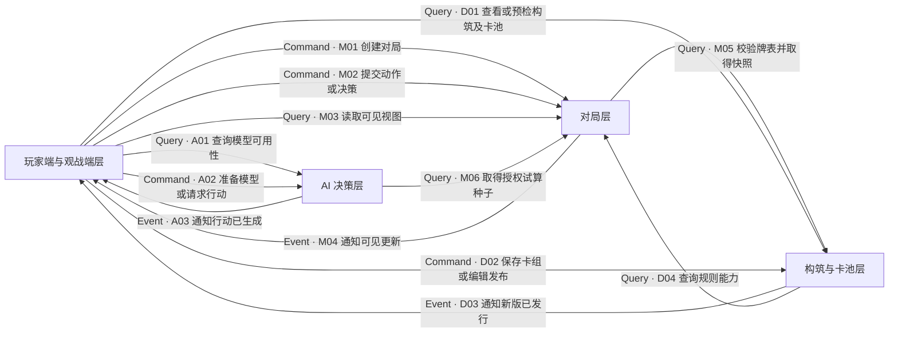
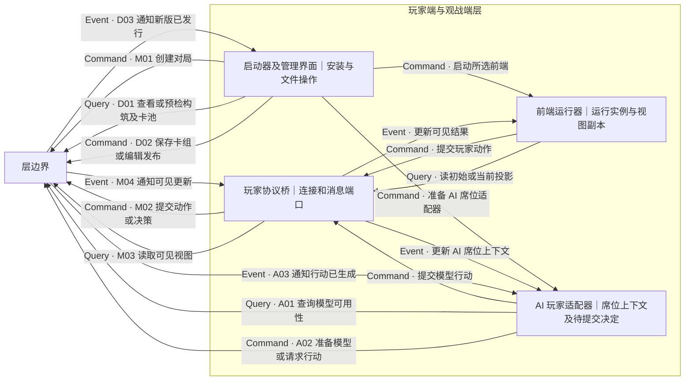
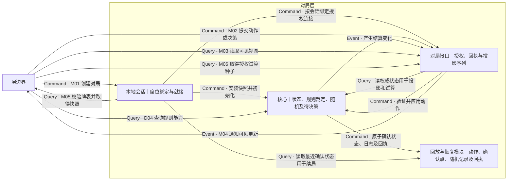
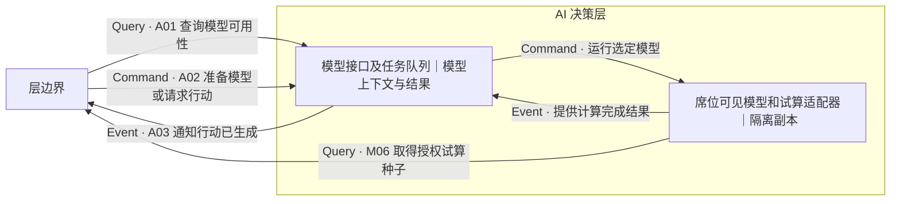
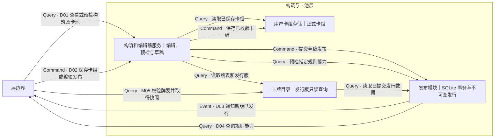

# 四层架构与交互图

箭头标记采用「语义 · ID 业务含义」。返回沿原命令或查询返回。跨层交互的请求和状态归属见[业务契约](business-interactions.md)和[数据模型](../data-model.md)。

## 层级总图

## 玩家端与观战端层

## 对局层

## AI 决策层

## 构筑与卡池层

关键路径为 M01 → M05 → M04 的对局准备，M02 → M04 → M02 的暂停恢复，M04 → A02 → A03 → M02 的 AI 行动，以及 D02 → D04 → D03 的发布。AI 预检与双席准备通过 A01 和 A02 完成。观战接入读取 M03 的公开投影，后续接收 M04。

云端调试前端在测试构建中以自定义前端身份接入玩家端的前端运行器与协议桥，沿 M02、M03 和 M04 交互。四层业务入口及云端正反用例见[云端验收契约](cloud-testing.md)。
