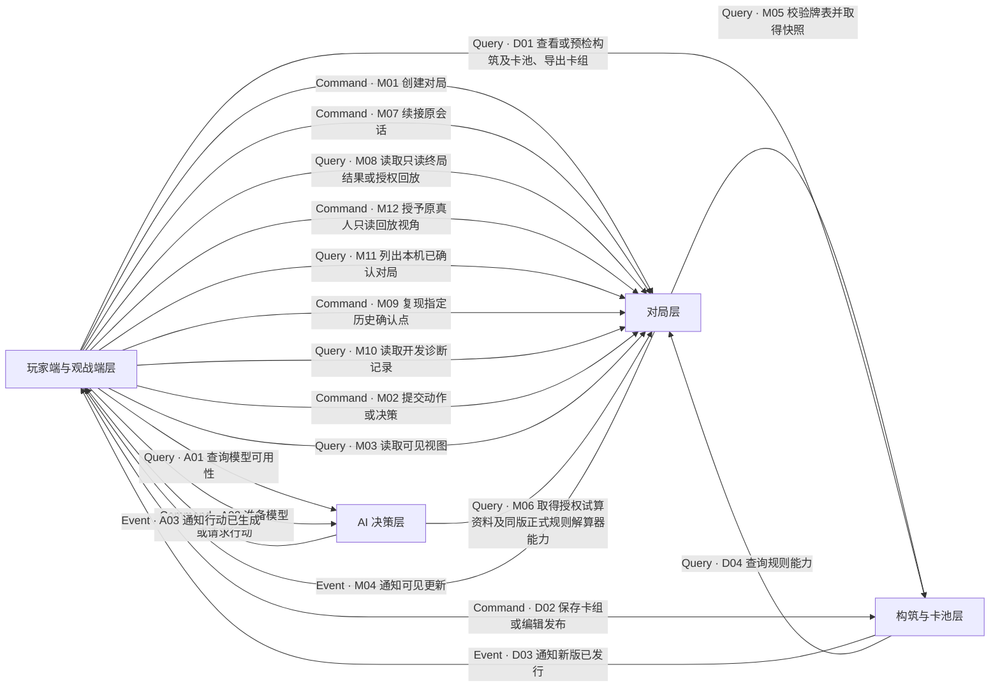
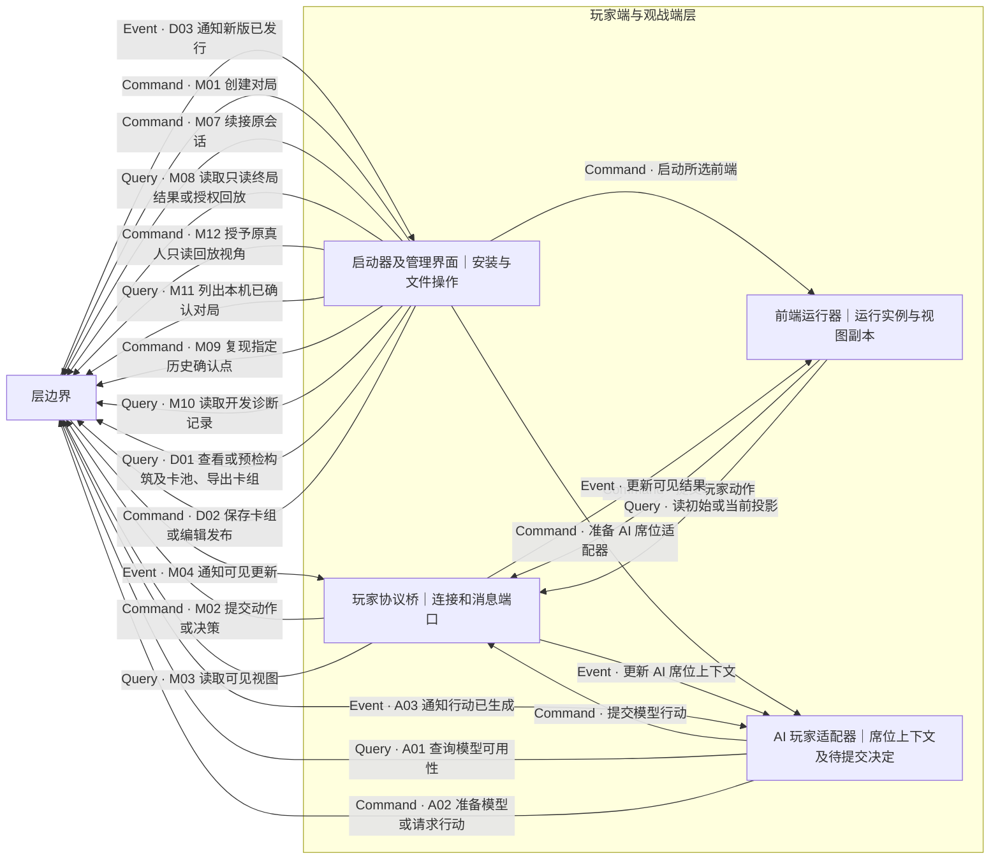
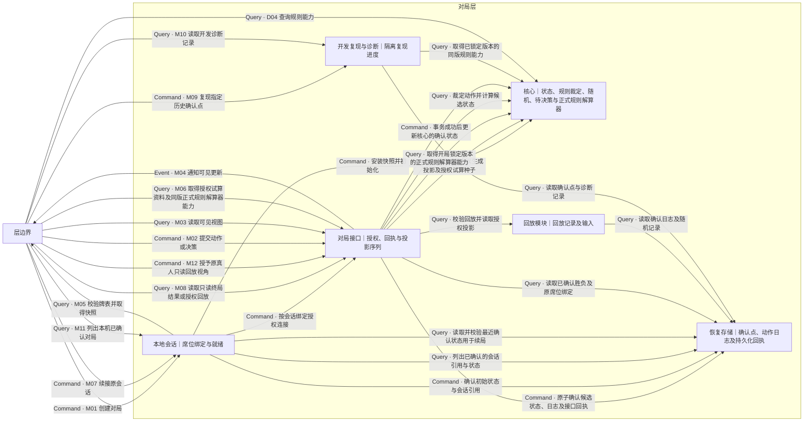
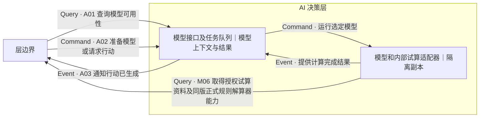
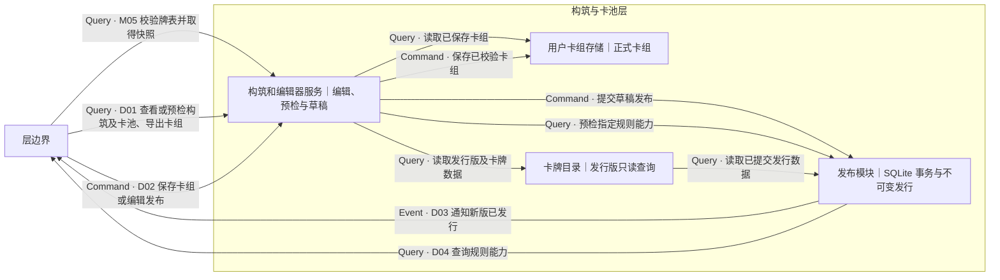

# 四层架构与交互图

箭头标记采用「语义 · ID 业务含义」。返回沿原命令或查询返回。跨层交互的请求和状态归属见[业务契约](business-interactions.md)和[数据模型](../data-model.md)。

## 层级总图

## 玩家端与观战端层

## 对局层

## AI 决策层

## 构筑与卡池层

关键路径为 M01 → M05 → M04 的对局准备，M02 → M04 → M02 的暂停恢复，M04 → A02 → A03 → M02 的 AI 行动，以及 D02 → D04 → D03 的发布。模型需要试算时，在 A02 与 A03 之间通过 M06 取得授权资料并在隔离副本上解算。AI 预检与双席准备通过 A01 和 A02 完成。观战接入读取 M03 的公开投影，后续接收 M04。提交由接口串行调度，核心计算候选，恢复模块原子写入，接口在确认成功后分发 M04。启动器经 M11 找到已确认对局。未结束的对局经 M07 重新建立连接，再经 M03 读取原局授权视图。已结束的对局经 M08 取得只读结果或公开回放。查看原真人视角时，先经 M12 登记只读授权，再经 M08 读取。可信宿主内的开发复现与诊断导出分别经 M09、M10。
