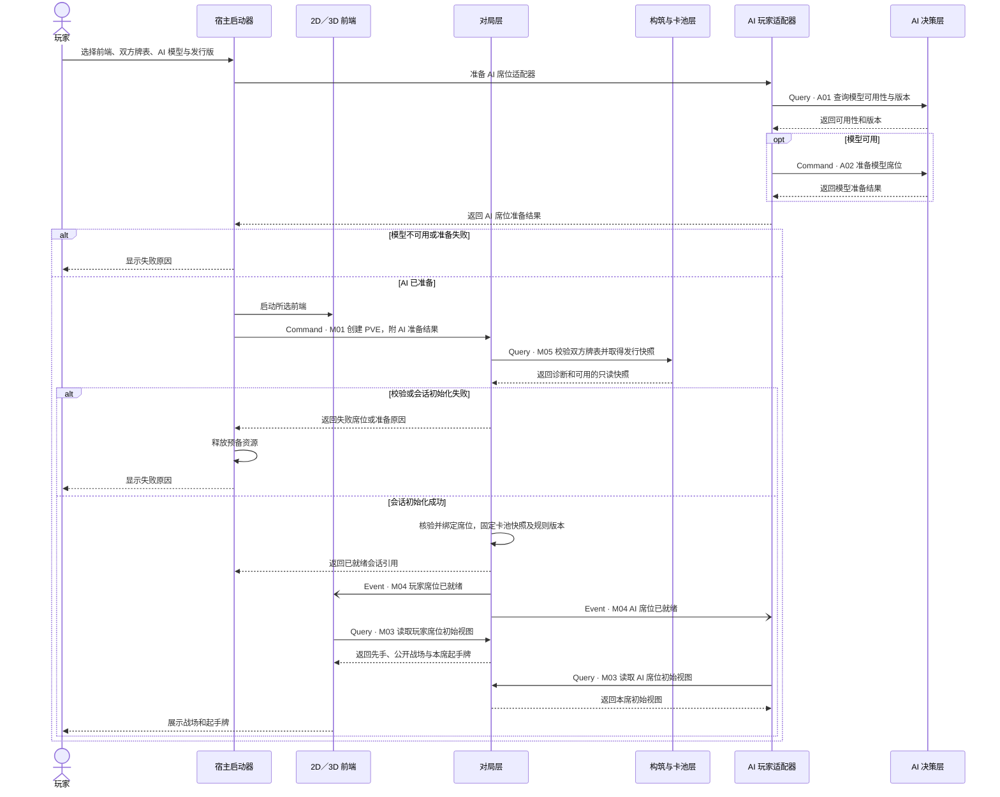
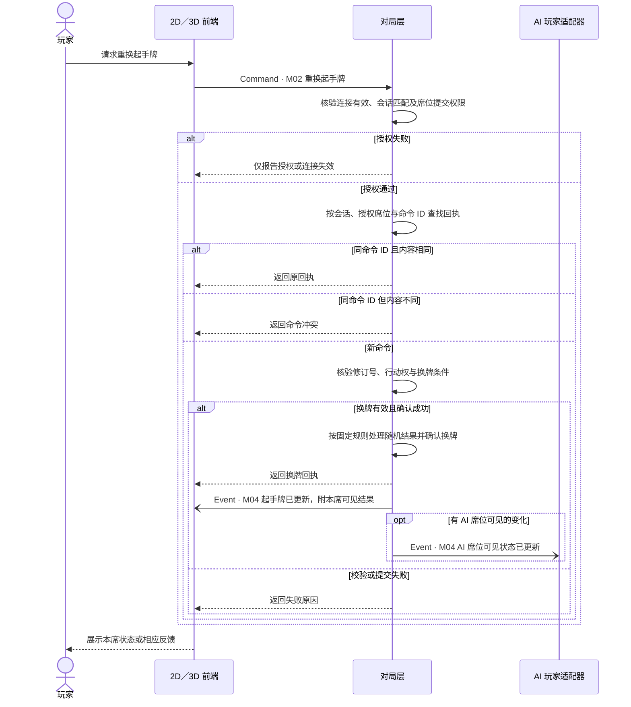
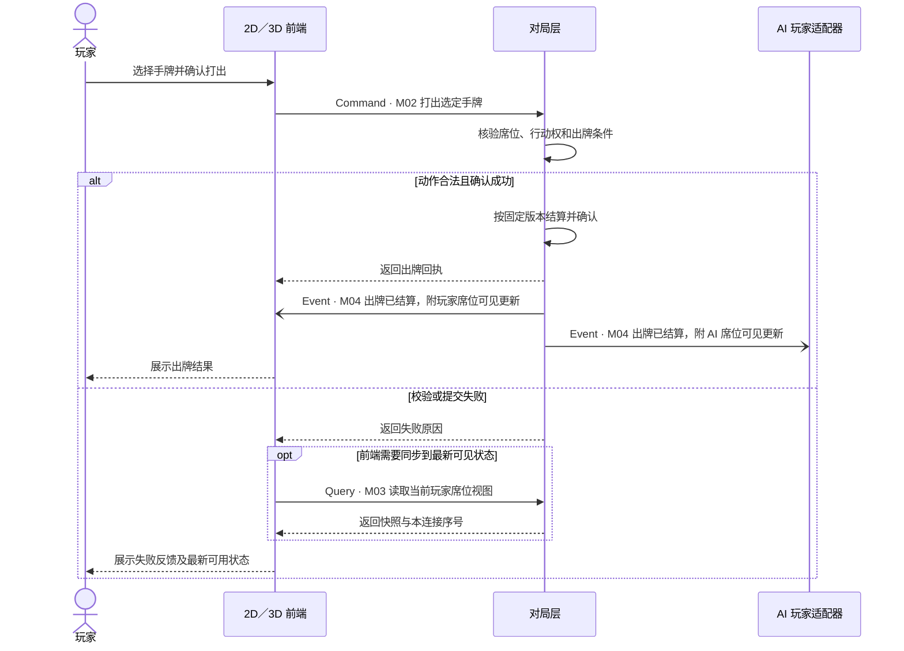
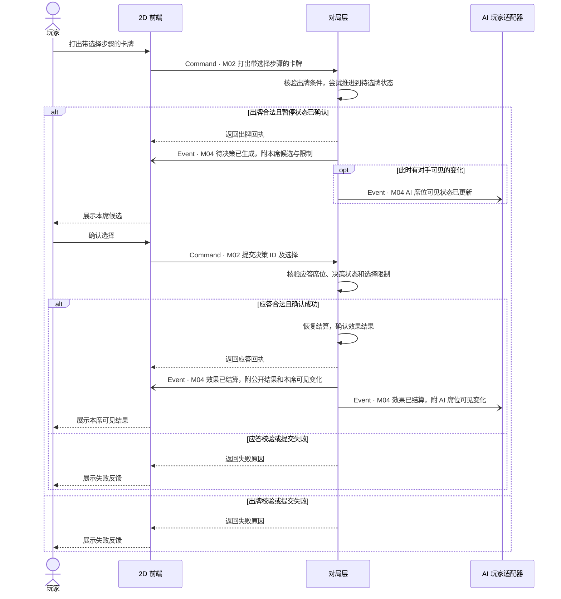
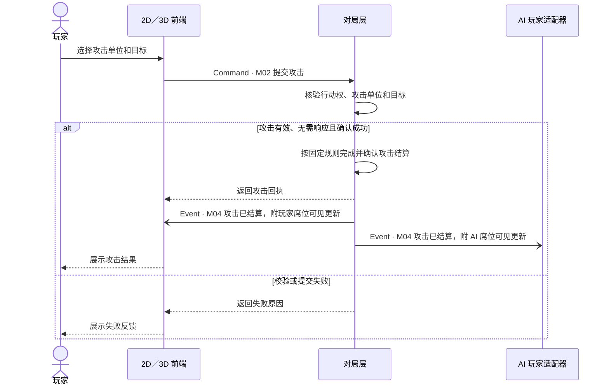
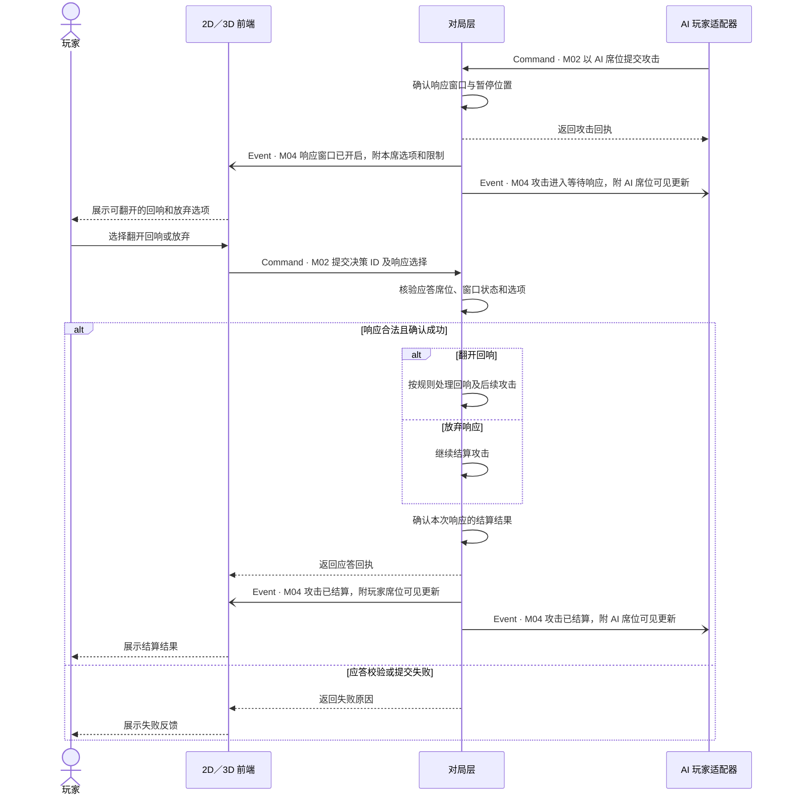
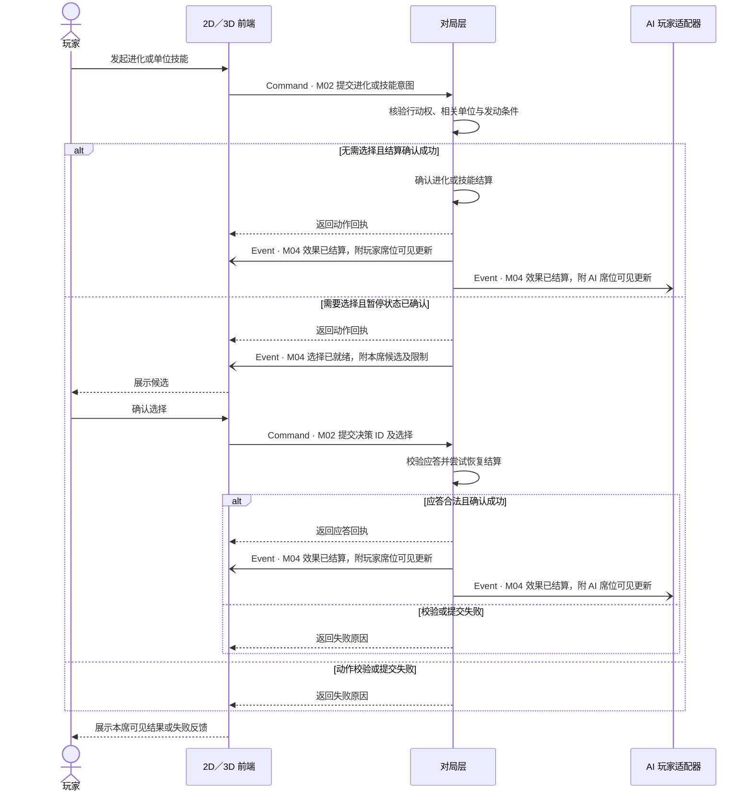
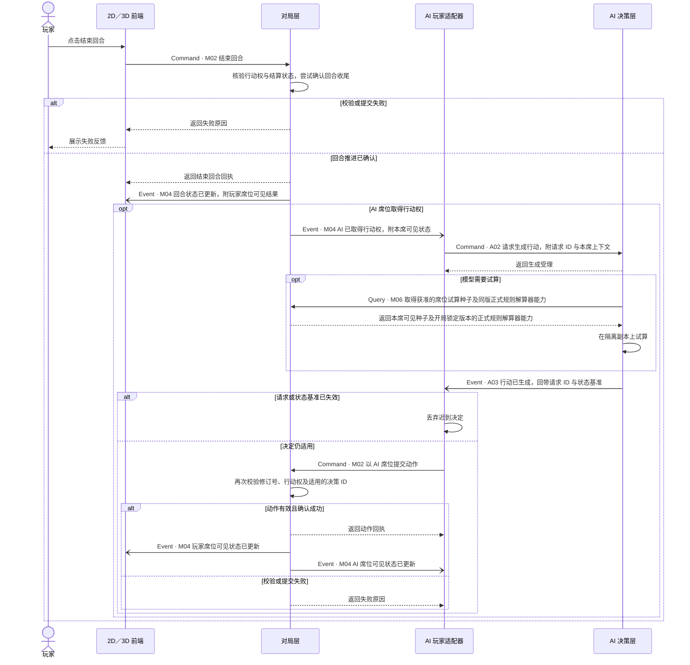
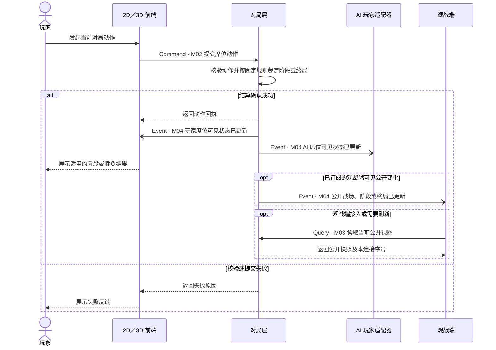
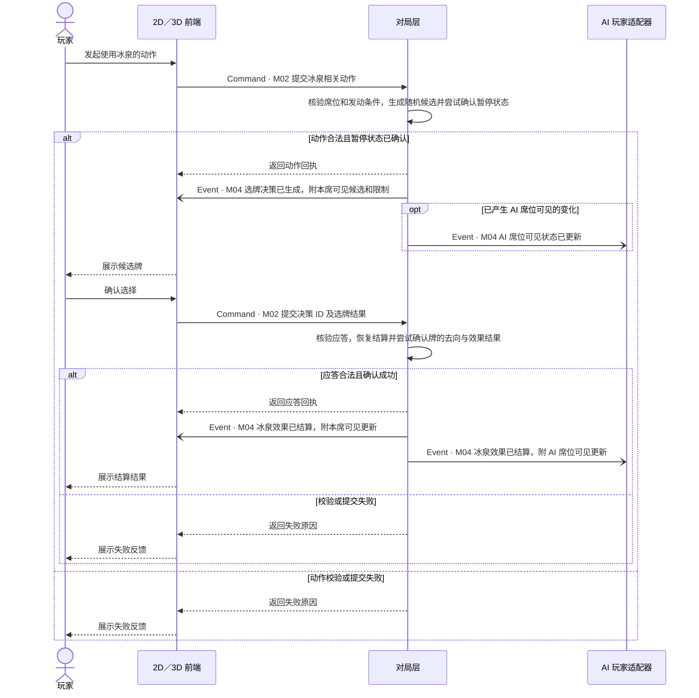

# 对局场景时序图

这十张图按[功能规格](../spec.md)、[四层边界](layer-boundaries.md)和[业务交互契约](business-interactions.md)描述重构后的业务时序。数字编号对应场景，消息上的 M、A 编号对应契约。

- 启动器、前端、AI 玩家适配器和观战端属于玩家端与观战端层。图中前端、AI 玩家适配器与对局之间的玩家协议消息均经玩家协议桥。对局层涵盖会话、统一接口、核心、视图投影和历史记录。
- 实线表示命令、查询或层内调用，虚线表示原请求的返回，开放箭头表示已发生的事件。玩家操作和层内步骤直接写业务含义。图中仅展示经过的参与者。
- M02 携带命令 ID 与期望修订号，决策应答另带决策 ID。对局接口先核验连接有效、目标会话匹配且连接有权为该席位提交命令，通过后才按会话、授权席位与命令 ID 查找回执。授权失败时仅报告授权或连接失效。同 ID 同内容重试返回原回执，同 ID 不同内容返回冲突，其余新命令继续核验修订号、行动权和决策有效性。合法决策只消费一次。后续各图中的 M02 均遵循该顺序。 [M02 契约](business-interactions.md#稳定标识与传输)
- 图中的「确认」表示候选状态的权威快照、历史和命令回执已在同一事务提交。事务成功后才返回正式回执和发布 M04。事务失败保留上次确认进度。各连接接收自己的有序可见事件，发现序号缺口时可用 M03 重取快照。
- 卡牌效果、换牌限制、终焉阈值和阶段裁定顺序由开局锁定的规则版本与卡池快照决定。

## 1. 玩家从前端启动真人对 AI 对局

玩家在宿主启动器选官方 2D 或 3D、双方牌表和发行版。启动器预备 AI，随后请求对局层建立会话。各席位就绪后取得自己的初始视图。

## 2. 玩家重换起手牌

按 [LG-01](legacy-samples.md#样本与观察点) 对照。旧版窗口为先手的首个全局回合主阶段、未换过牌且手牌非空。越权、重复或窗口关闭时，迁移版说明原因，保持原牌区。

核心校验换牌资格并处理随机结果。成功后，本席收到新的起手牌，对手仅收到其可见变化。

## 3. 玩家从手牌打出一张牌

按 [LG-02](legacy-samples.md#样本与观察点) 对照普通脉冲。当前行动席位须处于主阶段、未进入锁定手牌的战斗态、无等待中的结算，并满足费用、目标与卡牌特定限制。拒绝时保留手牌与原局面。

以一张可直接结算的手牌为例。核心按规则裁定出牌，对局接口向双方提供各自可见的结算结果。

## 4. 玩家使用带选择步骤的卡牌

待决策在属于该席的有效决策被合法消费、由规则取消或对局终止时关闭。非法应答或事务失败保留上次确认的暂停点。

出牌和选择确认分别提交。核心确认暂停进度后，选择候选只交付有权应答的席位。结算后，各连接只收到其授权范围内的变化。

已确认的待决策状态可在重启后恢复。若应答结果已确认但回执未送达，重新授权的席位以同 ID、同内容重试可取得原回执。[恢复验收](../spec.md#success-criteria-mandatory)

## 5. 玩家指挥单位攻击

按 [LG-03](legacy-samples.md#样本与观察点) 对照。当前行动席位在可攻击的主阶段且无等待中的结算才可提交。单位须就绪、尚未攻击且没有眩晕或攻击锁，普通阶段须有 AP。目标遵守守护、隐匿、核心须空场及先手首回合限制。拒绝时不消耗 AP 或改变攻击状态。

玩家选择单位和目标。核心裁定攻击。此图展示直接结算路径，需要等对手响应的路径见场景 6。

## 6. 玩家在对手回合翻开回响

按 [LG-06](legacy-samples.md#样本与观察点) 对照。只有符合触发条件的盖牌持有席可应答，每个触发事件可翻开一张或放弃。窗口在合法应答确认、触发事件因规则失效或终局时关闭。无效应答或事务失败时，拒绝仅反馈给请求方，原暂停点、候选及攻击进度保持，无新增可见事件。等待期间，对手及观战只见可公开的等待状态，不获得盖牌身份或选择列表。翻开时双方及观战可见翻开的回响、公开区域变化、原攻击取消或继续的结果。放弃时盖牌保持，对手及观战只见原攻击的公开后续，持有席仍可查看本席盖牌。

以 AI 的合法攻击触发响应窗口为例。玩家选择翻开回响或放弃响应，核心验证选择之后继续处理原攻击。

## 7. 玩家让单位进化或发动技能

进化按 [LG-04](legacy-samples.md#样本与观察点) 对照出牌窗口，并校验进化牌与本席前置锚点。技能按 [LG-05](legacy-samples.md#样本与观察点) 对照，在本席主阶段无待结算时可发动，战斗态仍可发动符合条件的单位技能。限次、字段锁或目标不符须返回对应原因，保持上次确认的局面。

核心使用指定版本裁定进化和技能条件。动作可以直接确认，也可以先确认待决策状态，再等待玩家补充选择。

## 8. 玩家结束回合，AI 接手

核心确认回合交接。AI 适配器按本席观察请求决定，丢弃失效决定，再把有效动作提交给对局层复核。模型试算只使用授权资料和隔离副本。

## 9. 对局进入终焉或分出胜负

按 [LG-07](legacy-samples.md#样本与观察点) 对照锁定版本。当前回合先完成结束处理并弃至 7 张，在回合结束检查双方弃牌区合计是否至少 40。未终局且首次达阈值时切换终焉、按先手 6 张和后手 7 张重抽，再由对手开始回合。之后攻击不耗 AP，王牌仍耗 1 AP。核心生命归零按规则确认胜负。各席和观战均可见阈值、阶段、公开区域、手牌张数和终局，各席只获本席重抽牌身份。

一次合法动作的结算可能改变对局阶段或产生终局。核心按开局规则裁定并确认状态，观战连接读取公开投影。

## 10. 玩家使用百川冰泉

按 [LG-08](legacy-samples.md#样本与观察点) 对照「探珠」。冰泉洗混并抽取至多三张，选一张，未选项先进入弃牌区。选中的锚点可打出时入场并结算，其脉冲分支执行效果后进入弃牌区，无法打出的选择退回冰泉。冰泉是公开区域，其可见牌与数量、公开弃牌和战场结果对双方及观战可见。应答席收到有序候选及选择限制，原随机输入及抽样顺序限内部复现。续局保留候选、决策 ID 与结算位置。

以一次需要随机产生候选并等待玩家选牌的冰泉效果为例。核心先确认随机候选与待决策状态，再按合法应答确认牌的去向和效果结果。

