# 对局场景时序图

这些图按[功能规格](../spec.md)、[四层边界](layer-boundaries.md)和[业务交互契约](business-interactions.md)描述重构后的业务时序。数字编号对应场景，消息上的 M、A 编号对应契约。

- 启动器、前端、AI 玩家适配器和观战端属于玩家端与观战端层。图中前端、AI 玩家适配器与对局之间的玩家协议消息均经玩家协议桥。对局层涵盖会话、统一接口、核心、视图投影和历史记录。
- 实线表示命令、查询或层内调用，虚线表示原请求的返回，开放箭头表示已发生的事件。玩家操作和层内步骤直接写业务含义。图中仅展示经过的参与者。
- M02 携带命令 ID 与从授权视图取得的预期状态标记，决策应答另带决策 ID。对局接口先核验连接有效、目标会话匹配且连接有权为该席位提交命令，通过后才按会话、授权席位与命令 ID 查找请求摘要和回执。授权失败时仅报告授权或连接失效。未结束对局中有确认回执的同 ID 同内容重试返回原回执，同 ID 不同内容返回冲突。此前因规则被拒的同 ID 同内容重试与未登记的新命令均按当前确认局面核验原请求。规则拒绝只登记请求摘要。合法决策只消费一次。后续各图中的 M02 均遵循该顺序。 [M02 契约](business-interactions.md#稳定标识与传输)
- 图中的「确认」表示候选状态的权威快照、历史和命令回执已在同一事务提交。事务成功后才返回正式回执和发布 M04。事务失败保留上次确认进度。各连接接收自己的有序可见事件，发现序号缺口时可用 M03 重取快照。
- 卡牌效果、换牌限制、终焉阈值和阶段裁定顺序由开局锁定的规则版本与卡池快照决定。

## 1. 玩家从前端启动真人对 AI 对局

玩家在宿主启动器选官方 2D 或 3D、双方牌表和发行版。启动器预备 AI，随后请求对局层建立会话。各席位就绪后取得自己的初始视图。

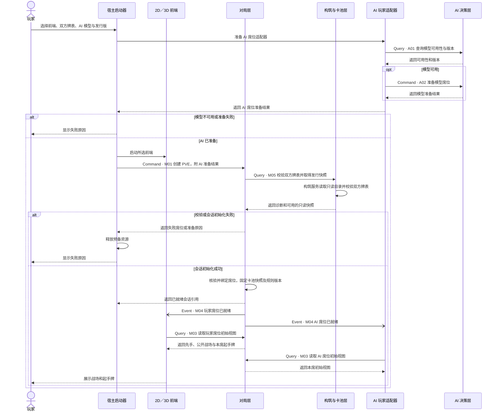

## 2. 玩家重换起手牌

按 [LG-01](legacy-samples.md#样本与观察点) 对照。旧版窗口为先手的首个全局回合主阶段、未换过牌且手牌非空。越权、重复或窗口关闭时，迁移版说明原因，保持原牌区。

核心校验换牌资格并处理随机结果。成功后，本席收到新的起手牌，对手仅收到其可见变化。

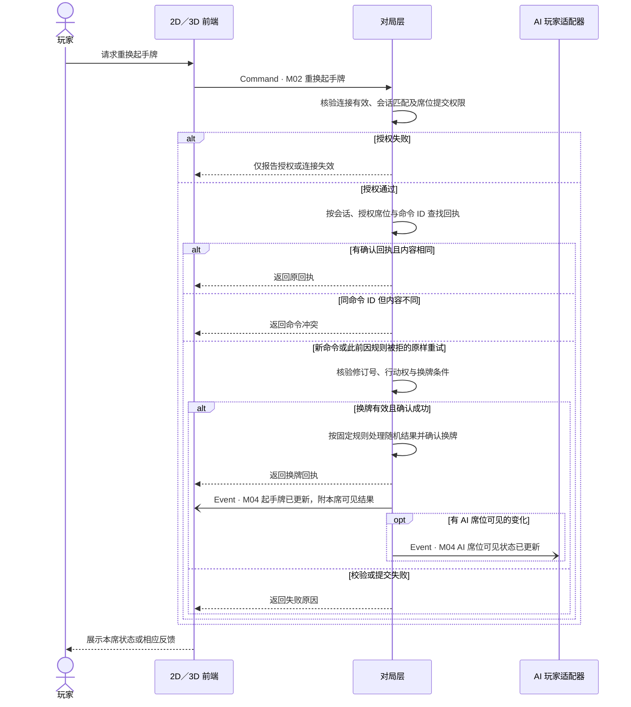

## 3. 玩家从手牌打出一张牌

按 [LG-02](legacy-samples.md#样本与观察点) 对照普通脉冲。当前行动席位须处于主阶段、未进入锁定手牌的战斗态、无等待中的结算，并满足费用、目标与卡牌特定限制。拒绝时保留手牌与原局面。

以一张可直接结算的手牌为例。核心按规则裁定出牌，对局接口向双方提供各自可见的结算结果。

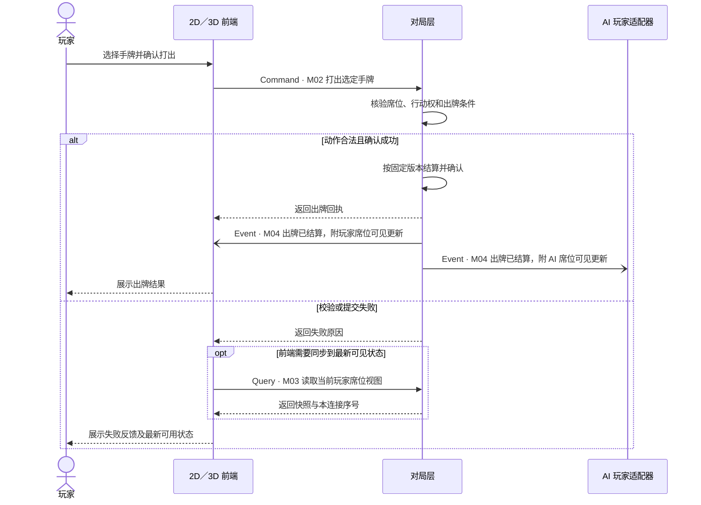

## 4. 玩家使用带选择步骤的卡牌

待决策在属于该席的有效决策被合法消费、由规则取消或对局终止时关闭。非法应答或事务失败保留上次确认的暂停点。

核心按[卡牌选择结算原则](../spec.md#卡牌选择结算原则)生成实际合法决定。条件须足额，结果可按实际候选结算；可放弃时把放弃计为一个决定。需要应答时，出牌和选择分别提交。唯一合法决定、条件不成立或结果为空时，核心按适用分支直接推进并确认。对手和观战可看到同一公开选择过程，只有应答席收到私有候选或具有应答权。

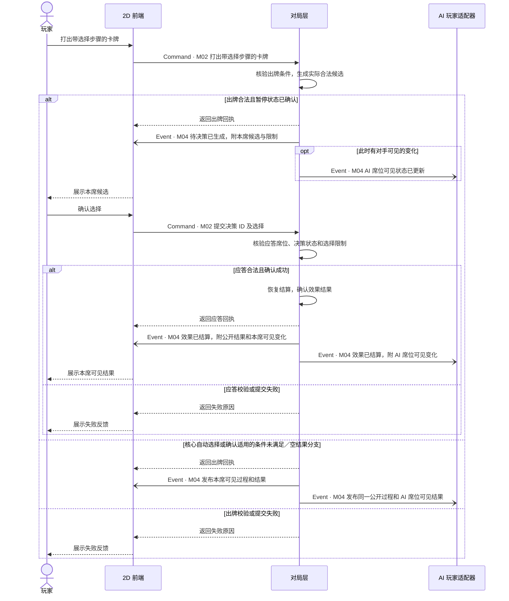

已确认的待决策状态可在重启后恢复。若应答结果已确认、对局仍未结束且回执未送达，重新授权的席位以同 ID、同内容重试可取得原回执。[恢复验收](../spec.md#success-criteria-mandatory)

## 5. 玩家指挥单位攻击

按 [LG-03](legacy-samples.md#样本与观察点) 对照。当前行动席位在可攻击的主阶段且无等待中的结算才可提交。单位须就绪、尚未攻击且没有眩晕或攻击锁，普通阶段须有 AP。目标遵守守护、隐匿、核心须空场及先手首回合限制。拒绝时不消耗 AP 或改变攻击状态。

玩家选择单位和目标。核心裁定攻击。此图展示直接结算路径，需要等对手响应的路径见场景 6。

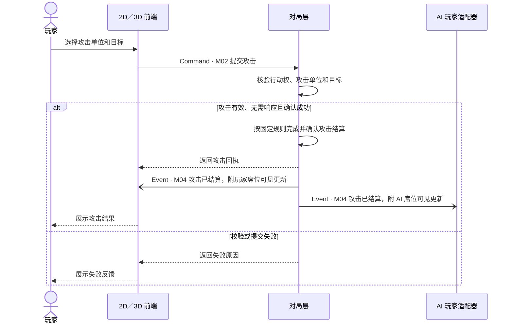

## 6. 玩家在对手回合翻开回响

按 [LG-06](legacy-samples.md#样本与观察点) 对照。只有符合触发条件的盖牌持有席可应答。对于牌面允许选择是否翻开的回响，每个触发事件可翻开一张或放弃，即使只有一张合格盖牌也保留两种决定。牌面规定满足条件即自动适用的效果直接应用，无放弃选项。下图展示「镇岳」的可选分支。窗口在合法应答确认、触发事件因规则失效或终局时关闭。无效应答或事务失败时，拒绝仅反馈给请求方，原暂停点、候选及攻击进度保持，无新增可见事件。等待期间，对手及观战只见可公开的等待状态，不获得盖牌身份或选择列表。翻开时双方及观战可见翻开的回响、公开区域变化、原攻击取消或继续的结果。放弃时盖牌保持，对手及观战只见原攻击的公开后续，持有席仍可查看本席盖牌。

以 AI 的合法攻击触发响应窗口为例。玩家选择翻开回响或放弃响应，核心验证选择之后继续处理原攻击。

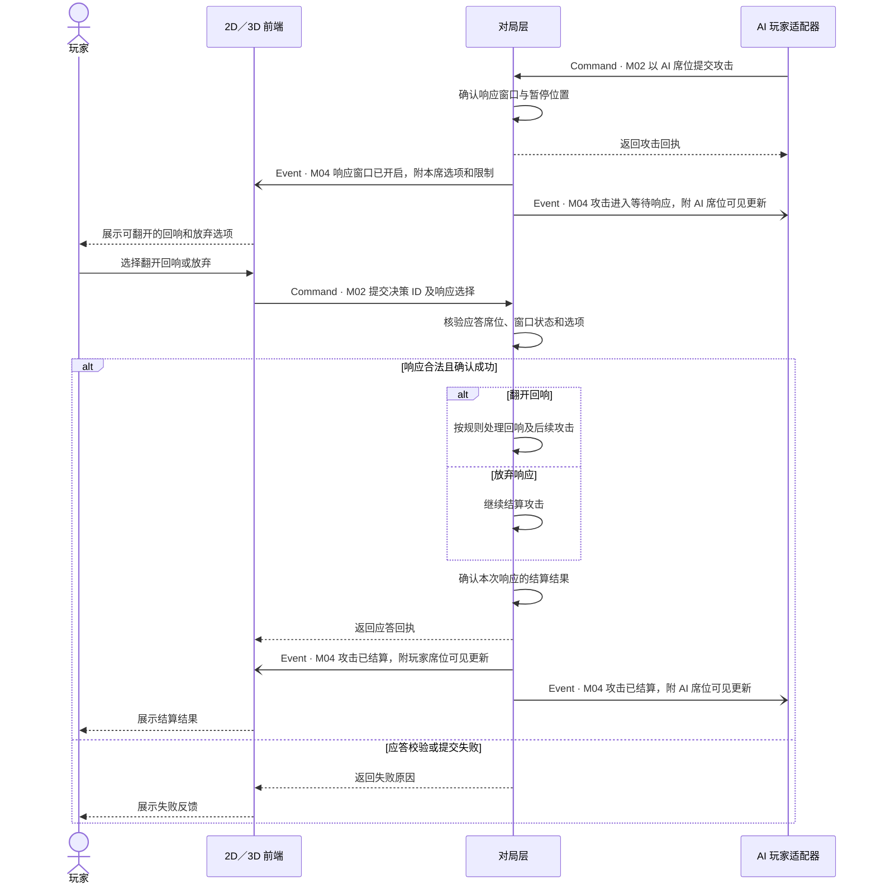

## 7. 玩家让单位进化或发动技能

进化按 [LG-04](legacy-samples.md#样本与观察点) 对照出牌窗口，并校验进化牌与本席前置锚点。技能按 [LG-05](legacy-samples.md#样本与观察点) 对照，在本席主阶段无待结算时可发动，战斗态仍可发动符合条件的单位技能。限次、字段锁或目标不符须返回对应原因，保持上次确认的局面。

核心使用指定版本裁定进化和技能条件。动作可以直接确认，也可以先确认待决策状态，再等待玩家补充选择。

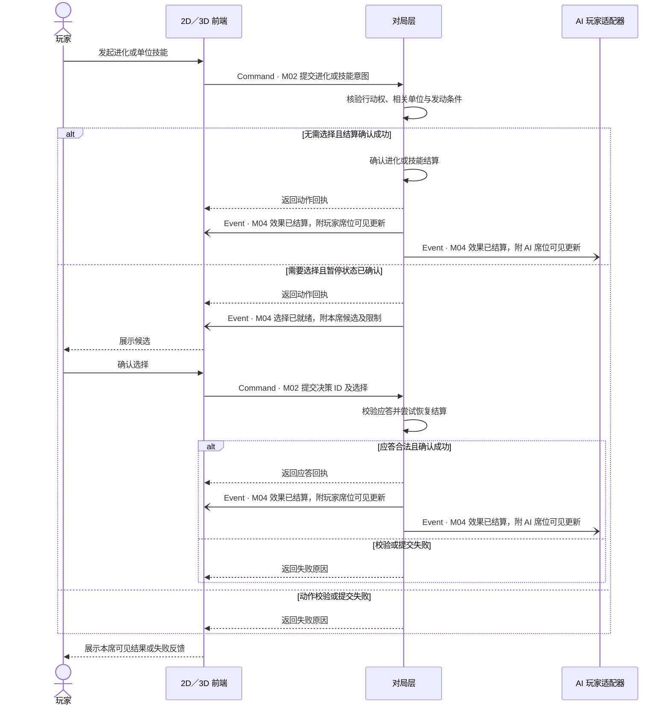

## 8. 玩家结束回合，AI 接手

核心确认回合交接。AI 适配器按本席观察请求决定，丢弃失效决定，再把有效动作提交给对局层复核。模型试算只使用授权资料和隔离副本。对局层的可信宿主先登记获准的 V6 内部任务，再由 M06 核验并读取迁移必需的真实隐藏字段，行动通知只返回行动意图和关联标识。

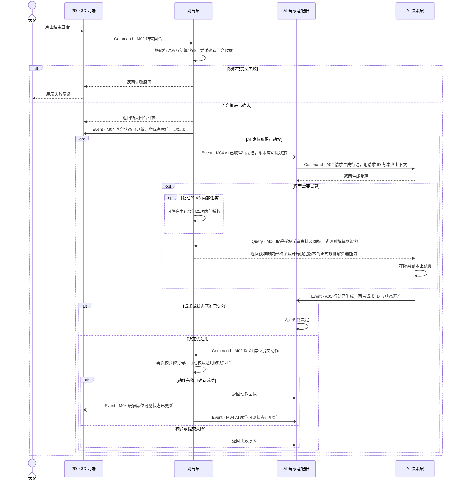

## 9. 对局进入终焉或分出胜负

按 [LG-07](legacy-samples.md#样本与观察点) 对照锁定版本。当前回合先完成结束处理并弃至 7 张，在回合结束检查双方弃牌区合计是否至少 40。未终局且首次达阈值时切换终焉、按先手 6 张和后手 7 张重抽，再由对手开始回合。之后攻击不耗 AP，王牌仍耗 1 AP。核心生命归零按规则确认胜负。各席和观战均可见阈值、阶段、公开区域、手牌张数和终局，各席只获本席重抽牌身份。

一次合法动作的结算可能改变对局阶段或产生终局。认输也通过 M02 由核心裁定，合法认输使对手获胜，并写入终局回放。终局确认即结束行动权。接口沿原请求向仍有效的发起连接返回该次回执，向各在线授权连接分别发布可见的终局更新，再关闭实时连接。未收到结果的玩家在重开后使用场景 12 的只读入口。

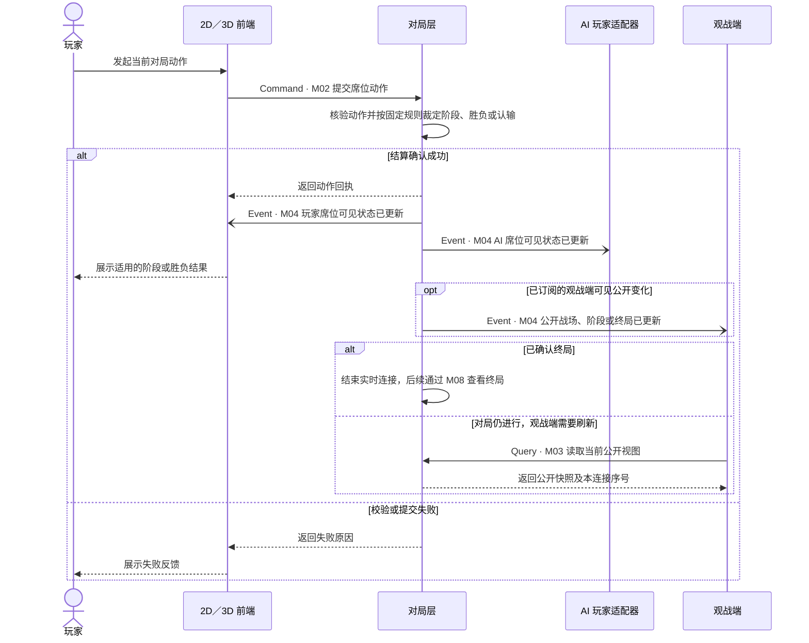

## 10. 玩家使用百川冰泉

按 [LG-08](legacy-samples.md#样本与观察点) 对照「探珠」。冰泉洗混并抽取至多三张，选一张，未选项先进入弃牌区。选中的锚点可打出时入场并结算，其脉冲分支执行效果后进入弃牌区，无法打出的选择退回冰泉。冰泉是公开区域。抽取后剩余的冰泉牌、抽出的公开候选及数量、选择方式和公开结果由双方及观战同步看到。公开候选以不暴露抽样顺序的方式呈现。原随机输入及抽样顺序限内部复现，应答席持有选择权。续局保留原候选、决策 ID 与结算位置。

冰泉有两张或三张候选时显示实际候选并等待选一张。有四张以上时抽三张后等待选一张。冰泉只有一张时自动选该张，按同样规则决定打出或退回，并确认结果。空冰泉按原效果结束该步骤。

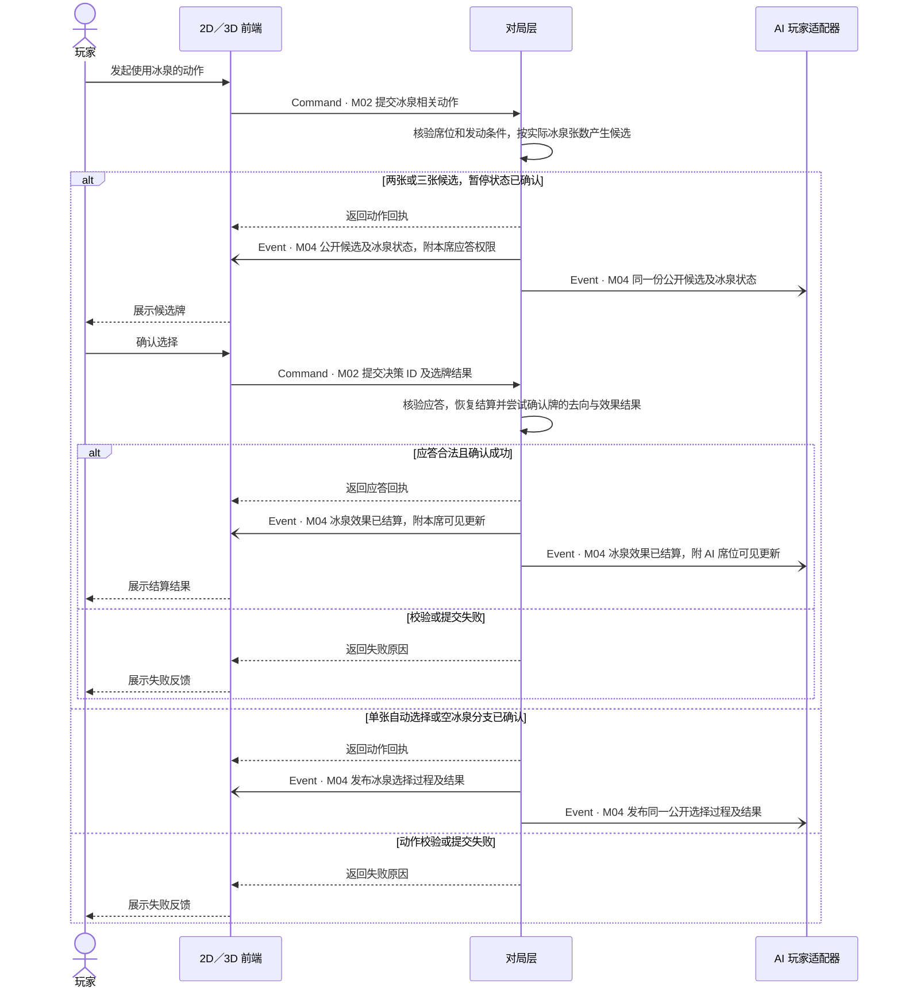

## 11. 重启后续接原会话

如果 M01 已确认创建但宿主未收到引用，重启后用 M11 找到原对局，再用 M07 续局。启动器按已确认的 AI 席位配置，经 A01 和 A02 重新准备适配器。失败时报告对应席位并保留原确认记录。旧 AI 任务失效，新适配器只根据恢复后的本席视图请求行动。

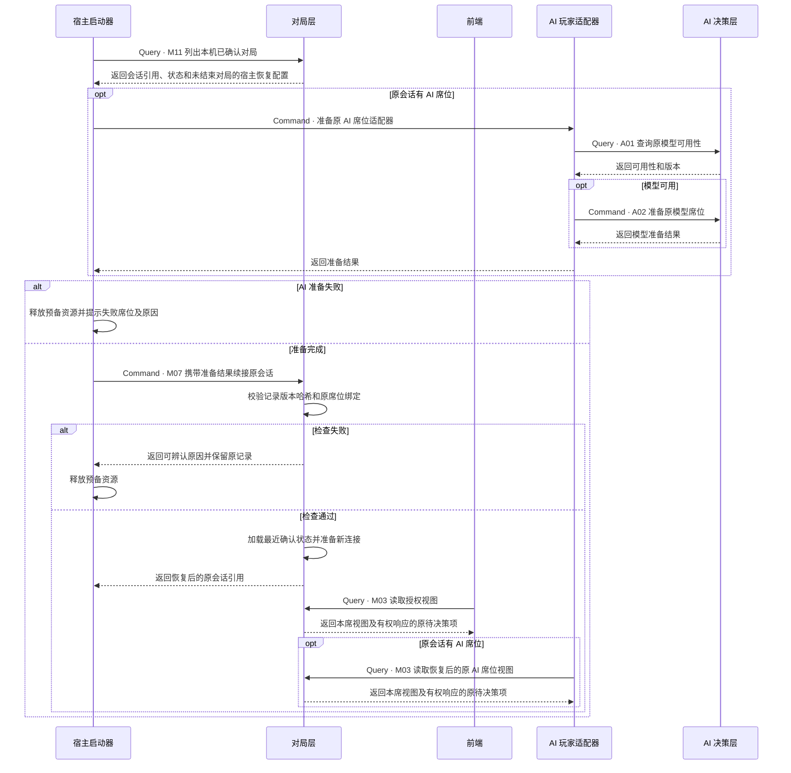

## 12. 查看终局、回放与开发排障

即使最后一步的回执或终局更新未送达，启动器也可从已确认记录读到胜负。原真人私有回放须由可信宿主确认本机操作者选择该视角并核验归档席位。可信启动器经 M12 登记该查看实例的只读权限。M08 读取已确认结果、公开回放或经 M12 授权的原真人私有回放。

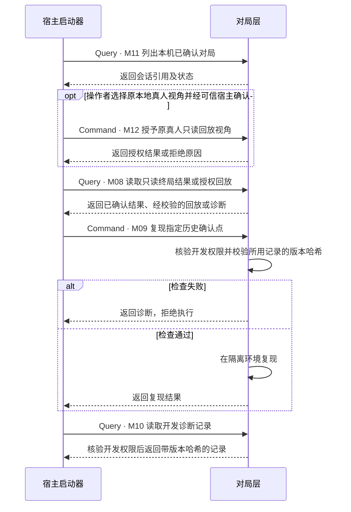
